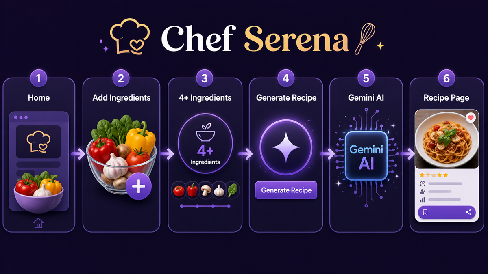
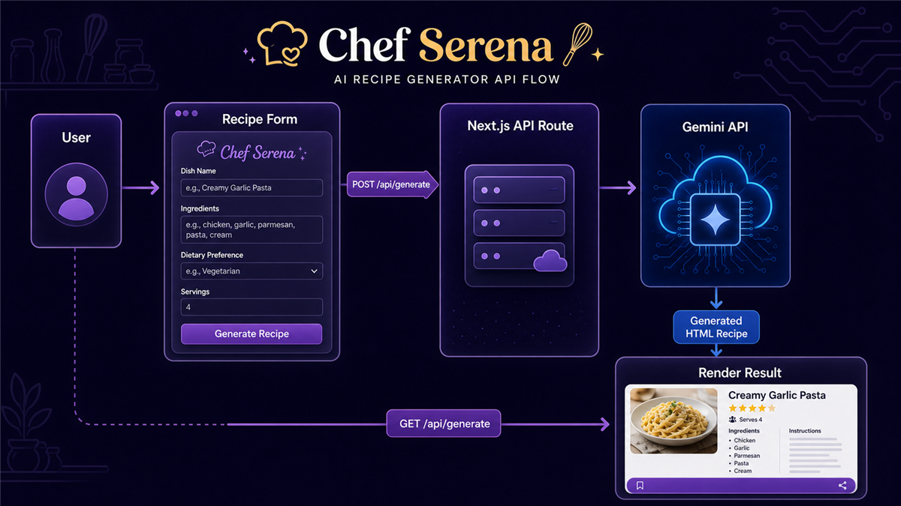

# Chef Serena 2.0

Chef Serena is an AI recipe generator built with Next.js. Users enter ingredients they already have, and the app sends that list to Google's Generative AI API to create a recipe recommendation. The generated recipe is returned as styled HTML and rendered in the app.

## Features

- Ingredient input flow with duplicate prevention.
- Recipe generation enabled after at least four ingredients are added.
- Server-side API route for calling the Google GenAI SDK.
- Animated landing page with a gradient background and product demo video.
- Motion-based transitions and loading indicator while the recipe is being generated.
- Responsive layout using Tailwind CSS utility classes.

## Tech Stack

| Area | Technology |
| --- | --- |
| Framework | Next.js 16 with App Router |
| Language | TypeScript |
| UI | React 19 |
| Styling | Tailwind CSS 4, shadcn configuration, tw-animate-css |
| Animation | motion |
| API client | axios |
| AI SDK | `@google/genai` |
| Rendering | Generated recipe HTML is rendered in the `/generate` page |

## App Workflow

1. The user lands on `/`, which shows the Chef Serena hero section, animated background, navigation, and demo video.
2. The user clicks `Try Now` or opens `/recipe`.
3. The `/recipe` page renders the ingredient form from `Main.tsx`.
4. Each submitted ingredient is formatted, checked for duplicates, and displayed in the ingredient list.
5. After four or more ingredients are added, the `Get a recipe` button appears.
6. Clicking the button sends a `POST` request to `/api/generate` with the ingredient list.
7. The API route calls Google GenAI using `GEMINI_API_KEY`.
8. The generated recipe HTML is stored server-side and the user is routed to `/generate`.
9. The `/generate` page sends a `GET` request to `/api/generate` and renders the generated recipe.

## Workflow Diagram

<p align="center">
  
</p>

## API Flow

<p align="center">
  
</p>

## Environment Variables

Create a `.env` file in the project root:

```env
GEMINI_API_KEY=your_google_genai_api_key
```

The API route reads this variable in `src/app/api/generate/route.ts`.

## Getting Started

Install dependencies:

```bash
npm install
```

Run the development server:

```bash
npm run dev
```

Open the app:

```txt
http://localhost:3000
```

## Available Scripts

```bash
npm run dev
```

Starts the Next.js development server.

```bash
npm run build
```

Builds the production app.

```bash
npm run start
```

Starts the production server after a build.

```bash
npm run lint
```

Runs ESLint.

## Main Files

- `src/app/page.tsx` - home page that renders the navbar and animated hero section.
- `src/app/recipe/page.tsx` - recipe input page.
- `src/app/generate/page.tsx` - generated recipe display page.
- `src/app/api/generate/route.ts` - API route that calls Google GenAI.
- `src/components/Main.tsx` - ingredient form, ingredient state, generate action, and routing.
- `src/components/Ingredients.tsx` - ingredient list and generate button.
- `src/components/Navbar.tsx` - shared navigation.
- `src/components/ui/background-gradient-animation.tsx` - animated background component.

## Future Improvements

- Replace module-level recipe storage with a database, session storage, or route payload.
- Render structured recipe data instead of raw HTML for better safety and styling control.
- Add validation and error messages for empty API responses or failed model calls.
- Add tests for ingredient handling and API behavior.
